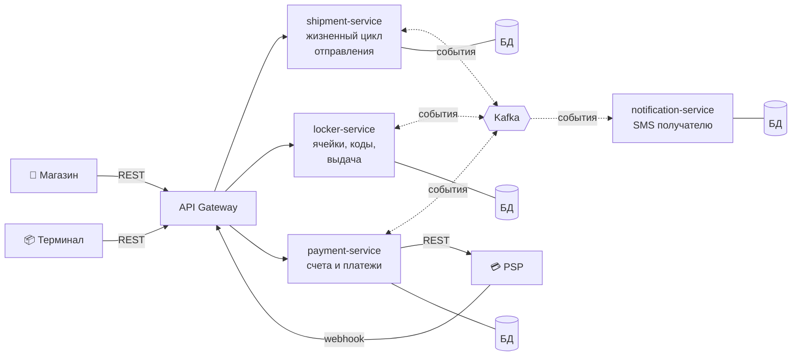

# LockerFlow — доставка заказов через сеть постаматов

Портфолио-проект системного аналитика: полный цикл проектирования микросервисной системы —
от бизнес-проблемы до контрактов, модели данных и **работающего прототипа**, на котором проверены
все описанные сценарии.

> Кейс учебный: компания и цифры вымышлены. Архитектура, контракты, код и тесты — настоящие и запускаются
> одной командой.

## О чём проект

Логистический оператор теряет деньги на повторных курьерских доставках и приёме наличных. Решение —
сеть постаматов с API для интернет-магазинов: магазин передаёт заказ, система резервирует ячейку,
курьер закладывает посылку, получатель оплачивает онлайн и забирает заказ по одноразовому коду.



## Что здесь можно посмотреть

| Компетенция аналитика | Артефакт |
|-----------------------|----------|
| Анализ предметной области, постановка задачи | [Видение и границы](docs/01-business/vision-and-scope.md) · [Глоссарий](docs/01-business/glossary.md) |
| Моделирование бизнес-процессов | [AS-IS / TO-BE](docs/01-business/business-processes.md) |
| Выявление и формализация правил | [13 бизнес-правил](docs/01-business/business-rules.md) с привязкой к коду и тестам |
| Разработка требований | [20 историй с Gherkin](docs/02-requirements/user-stories.md) · [6 Use Case](docs/02-requirements/use-cases.md) · [32 FR](docs/02-requirements/functional-requirements.md) · [38 NFR](docs/02-requirements/non-functional-requirements.md) |
| Трассировка требований | [Матрица: цель → история → требование → сервис → тест](docs/02-requirements/traceability-matrix.md) |
| Проектирование архитектуры | [C4](docs/03-architecture/c4.md) · [Декомпозиция на сервисы](docs/03-architecture/service-decomposition.md) |
| Обоснование решений | [8 ADR](docs/03-architecture/adr/README.md): альтернативы, компромиссы, условия пересмотра |
| Моделирование поведения | [Машины состояний](docs/03-architecture/state-machines.md) · [7 диаграмм последовательности](docs/03-architecture/sequences.md) |
| Проектирование данных | [ER-модели, словарь данных, индексы, ПДн](docs/04-data/data-model.md) |
| Проектирование REST API | [OpenAPI 3.0 — 4 спецификации](docs/05-integration/openapi/) · [Каталог ошибок](docs/05-integration/error-catalog.md) |
| Проектирование событийных интеграций | [AsyncAPI 3.0 — 17 событий](docs/05-integration/asyncapi/lockerflow-events.yaml) |
| Интеграции с внешними системами | [Каталог интеграций](docs/05-integration/integration-catalog.md): маппинги, таблицы решений, поведение при сбоях |
| Тест-дизайн | [Стратегия](docs/06-quality/test-strategy.md) · [12 тест-кейсов](docs/06-quality/test-cases.md) |
| Эксплуатационные требования | [Метрики, алерты, SLO](docs/06-quality/observability.md) |
| Планирование и риски | [Roadmap, WSJF, техдолг](docs/07-delivery/roadmap-and-backlog.md) · [Реестр рисков](docs/07-delivery/risks.md) |

Полная карта документов и система идентификаторов — в [docs/README.md](docs/README.md).

## Архитектурные паттерны

| Паттерн | Зачем | Где смотреть |
|---------|-------|--------------|
| Database per service | Сервисы не связаны общей схемой данных | [ADR-0002](docs/03-architecture/adr/0002-database-per-service.md), `deploy/init-databases.sql` |
| Event-driven, Kafka | Отказ одного сервиса не останавливает остальные | [ADR-0003](docs/03-architecture/adr/0003-async-messaging-kafka.md) |
| Хореографическая сага | Согласованность без распределённых транзакций | [ADR-0004](docs/03-architecture/adr/0004-choreography-saga.md), [SD-01](docs/03-architecture/sequences.md) |
| Transactional outbox | Событие публикуется тогда и только тогда, когда данные сохранены | [ADR-0005](docs/03-architecture/adr/0005-outbox-and-idempotent-consumer.md), `libs/lf_common/events.py` |
| Идемпотентный потребитель, DLQ | Повторная доставка не даёт повторных эффектов | там же |
| Idempotency-Key | Безопасные повторы запросов клиента | [ADR-0006](docs/03-architecture/adr/0006-api-idempotency.md) |
| Event-carried state transfer | Сервис принимает решение по локальной копии данных | [Владение данными](docs/03-architecture/service-decomposition.md) |
| Anti-corruption layer | Замена платёжного шлюза не затрагивает другие сервисы | `services/payment_service` |
| Подписанный webhook | Защита от подделки уведомлений об оплате | [INT-06](docs/05-integration/integration-catalog.md) |
| RFC 7807, correlation id | Единые ошибки и сквозная трассировка | [Каталог ошибок](docs/05-integration/error-catalog.md) |

## Запуск

Нужен только Docker.

```bash
docker compose up -d --build
```

Через минуту доступны:

| Что | Адрес |
|-----|-------|
| API Gateway (единая точка входа) | http://localhost:8080 |
| Swagger UI сервисов | http://localhost:8001/docs · [8002](http://localhost:8002/docs) · [8003](http://localhost:8003/docs) · [8004](http://localhost:8004/docs) |
| Эмулятор платёжного шлюза | http://localhost:8010/docs |

### Демонстрация сквозного сценария

```bash
python3 scripts/demo.py
```

Скрипт проходит путь «магазин создал заказ → ячейка зарезервирована → курьер заложил посылку →
получатель получил SMS → попытка забрать без оплаты отклонена → оплата → выдача» и печатает каждый шаг.

Параллельно можно смотреть, как события идут между сервисами:

```bash
docker compose logs -f | grep -E "event handled|SMS ->"
```

### Тесты

```bash
pip install -r requirements-dev.txt
```

```bash
python3 -m pytest -q
```

```bash
python3 -m pytest tests/e2e -v
```

```bash
./scripts/resilience_check.sh
```

| Набор | Количество | Что проверяет |
|-------|-----------:|---------------|
| Unit | 79 | Доменные правила: полная матрица переходов статусов, подбор ячейки, код получения, подпись webhook, шаблоны |
| Контрактные | 11 | Код не расходится с OpenAPI, AsyncAPI и каталогом ошибок |
| E2E | 13 | Бизнес-сценарии TC-01…TC-12 на живом стенде |
| Отказоустойчивость | 2 | События не теряются при остановке сервиса и брокера |

Остановить стенд и удалить данные:

```bash
docker compose down -v
```

## Структура репозитория

```
docs/                     аналитическая документация (7 разделов)
services/
  shipment_service/       отправления: API партнёров, статусная модель, контроль сроков
  locker_service/         постаматы: резерв, закладка, выдача по коду, изъятие
  payment_service/        платежи: счета, интеграция с PSP, webhook
  notification_service/   уведомления: шаблоны, журнал
  psp_mock/               тестовый двойник платёжного шлюза
  */schema.sql            DDL базы сервиса
  */domain.py             бизнес-правила без инфраструктуры
libs/lf_common/           общая платформенная библиотека: outbox, потребитель, ошибки
deploy/                   конфигурация шлюза и инициализация баз
tests/unit/               unit- и контрактные тесты
tests/e2e/                сквозные сценарии
scripts/                  демонстрация и проверка отказоустойчивости
```

## Что реализовано, а что только спроектировано

Прототип доказывает работоспособность архитектуры, но не является промышленной системой. Граница
проведена явно:

| Реализовано и проверено тестами | Спроектировано в документации |
|---------------------------------|-------------------------------|
| Все 15 историй MVP, 13 бизнес-правил | Истории развития US-16…US-20 (webhook партнёру, refund, продление) |
| Сага, outbox, идемпотентность, DLQ | Метрики, алерты, распределённая трассировка |
| Аутентификация партнёров, подпись webhook, хэширование кодов и ключей | Аутентификация терминалов (mTLS) и курьеров (JWT) |
| Стенд в Docker Compose | Отказоустойчивое развёртывание, нагрузочное тестирование |

Каждое упрощение записано: статус по каждому требованию — в [NFR](docs/02-requirements/non-functional-requirements.md),
технический долг — в [roadmap](docs/07-delivery/roadmap-and-backlog.md), следствия для безопасности —
в [реестре рисков](docs/07-delivery/risks.md) (R-07 прямо называет блокер для выхода в интернет).

## Как рассказывать о проекте на собеседовании

Маршрут на 10 минут:

1. **Проблема и цель** (1 мин) — [Видение](docs/01-business/vision-and-scope.md): три проблемы, пять измеримых целей.
2. **Процесс** (1 мин) — [TO-BE](docs/01-business/business-processes.md) и таблица сравнения с AS-IS.
3. **Одна история насквозь** (3 мин) — US-08 «Оплатить онлайн»: критерии приёмки → UC-03 с альтернативными
   потоками → [SD-03](docs/03-architecture/sequences.md) → контракт webhook и таблица решений в
   [INT-06](docs/05-integration/integration-catalog.md) → TC-02 и TC-11.
4. **Главное архитектурное решение** (3 мин) — почему создание отправления асинхронное:
   [ADR-0004](docs/03-architecture/adr/0004-choreography-saga.md), какие альтернативы отвергнуты и чем за это заплачено.
   Затем гонка «отмена обогнала резерв» — SD-06.
5. **Демонстрация** (2 мин) — `python3 scripts/demo.py` и лог событий.

Вопросы, к которым стоит быть готовым, и где искать ответ:

| Вопрос | Ответ |
|--------|-------|
| Что будет, если сервис упадёт после записи в БД, но до отправки события? | ADR-0005, SD-07, проверка RC-02 |
| Как избежать двойного списания? | ADR-0006, BR-10, BR-11, TC-02 |
| Почему оплата — отдельный атрибут, а не статус отправления? | [Машины состояний](docs/03-architecture/state-machines.md), раздел о статусе оплаты |
| Как locker-service узнаёт об оплате, не вызывая payment-service? | Таблица владения данными, SD-03 |
| Почему не монолит? | ADR-0001, включая «честную оговорку» |
| Что бы вы сделали иначе? | Технический долг TD-1…TD-7, открытые вопросы Q-1…Q-3, ADR-0008 |
| Какие самые опасные риски? | R-07 и R-01 в реестре рисков |

## Стек

Python 3.12 · FastAPI · PostgreSQL 16 · Apache Kafka 3.9 (KRaft) · nginx · Docker Compose · pytest ·
OpenAPI 3.0 · AsyncAPI 3.0 · Mermaid
