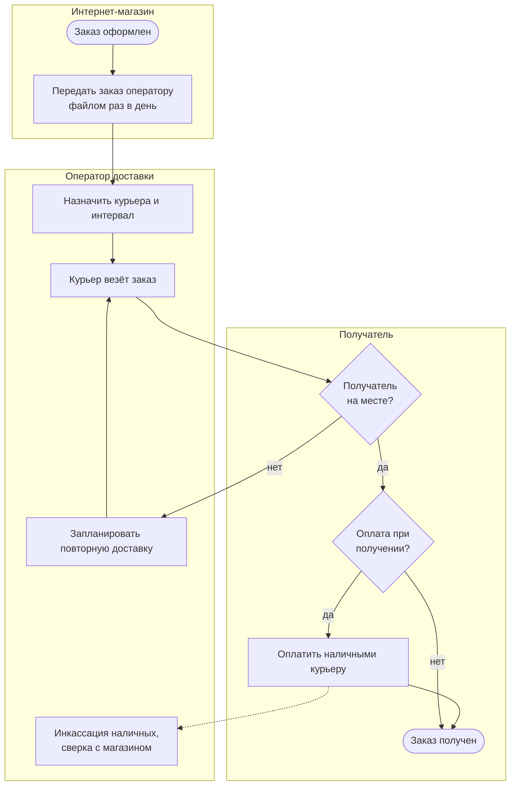
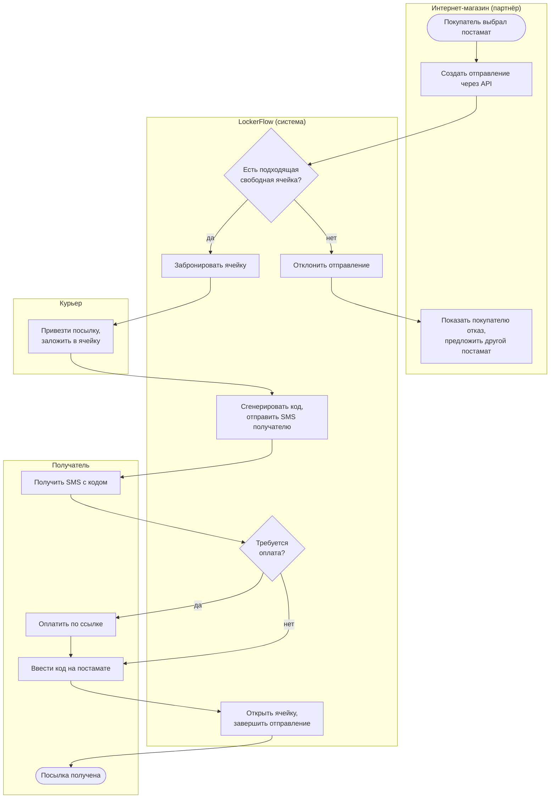
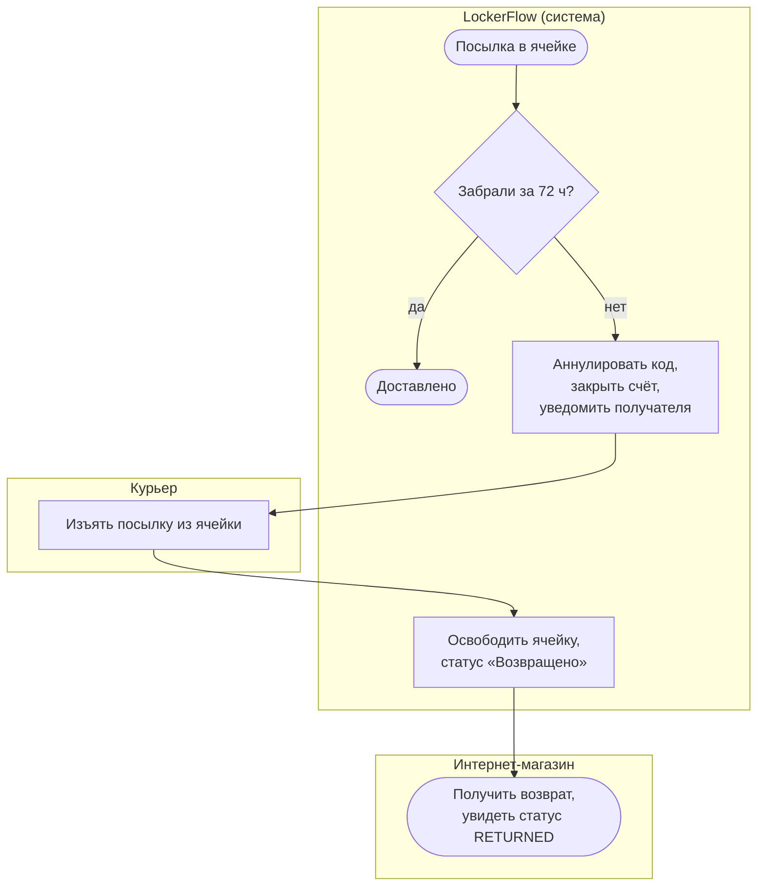

# Бизнес-процессы

Диаграммы выполнены в виде swimlane-схем (Mermaid). Нотация упрощённая: прямоугольник — действие,
ромб — развилка, скруглённый блок — начало/конец.

## 1. AS-IS: доставка курьером до двери

**Узкие места:** повторные доставки (P1), ожидание в интервале (P2), наличные (P3), передача заказов
файлом раз в сутки — нет онлайн-статусов.

## 2. TO-BE: доставка через постамат (основной процесс)

## 3. TO-BE: невостребованная посылка

## 4. Сравнение AS-IS и TO-BE

| Шаг процесса | AS-IS | TO-BE | Эффект |
|--------------|-------|-------|--------|
| Передача заказа | Файл раз в сутки | API в момент оформления | Статус доступен сразу (BG-4) |
| Проверка возможности доставки | Нет | Резерв ячейки до отгрузки | Нет «доставок в никуда» |
| Вручение | Личная встреча в интервале | Самостоятельно, 24/7, в течение 72 ч | Нет повторных выездов (BG-1) |
| Оплата | Наличные курьеру | Онлайн до открытия ячейки | Нет инкассации (BG-3) |
| Подтверждение вручения | Подпись в накладной | Событие открытия ячейки по коду | Объективный факт в системе (BG-5) |
| Возврат невостребованного | По решению курьера | Автоматически по сроку | Предсказуемая оборачиваемость (BG-2) |

## 5. От процесса к требованиям

| Шаг TO-BE | Сценарий использования | Истории |
|-----------|------------------------|---------|
| Создать отправление, забронировать ячейку | [UC-01](../02-requirements/use-cases.md#uc-01-создать-отправление) | US-01, US-04 |
| Заложить посылку, отправить код | [UC-02](../02-requirements/use-cases.md#uc-02-заложить-посылку) | US-05, US-06 |
| Оплатить по ссылке | [UC-03](../02-requirements/use-cases.md#uc-03-оплатить-заказ) | US-08 |
| Ввести код, получить посылку | [UC-04](../02-requirements/use-cases.md#uc-04-получить-посылку) | US-07 |
| Отменить до отгрузки | [UC-05](../02-requirements/use-cases.md#uc-05-отменить-отправление) | US-03 |
| Невостребованная посылка | [UC-06](../02-requirements/use-cases.md#uc-06-вернуть-невостребованную-посылку) | US-10, US-11 |
