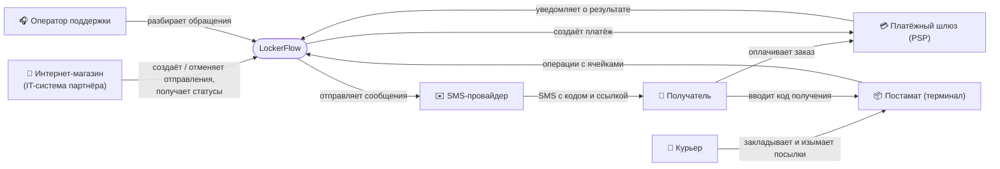

# Видение и границы проекта (Vision & Scope)

> Проект учебный: компания, цифры и стейкхолдеры вымышлены. Все количественные показатели
> в этом документе — **допущения**, принятые для постановки задачи, а не результаты измерений.

## 1. Контекст и проблема

**LockerFlow** — логистический оператор «последней мили», который доставляет заказы интернет-магазинов
курьерами до двери. У текущей модели три системные проблемы:

| # | Проблема | Как проявляется | Кого затрагивает |
|---|----------|-----------------|------------------|
| P1 | Неуспешные доставки | Получателя нет дома, курьер приезжает повторно — каждая вторая попытка оплачивается оператором | Оператор, магазин |
| P2 | Неудобные интервалы | Получатель вынужден ждать курьера в 4-часовом окне | Получатель |
| P3 | Наличные у курьера | Оплата при получении принимается наличными: инкассация, расхождения, риск потерь | Оператор, магазин |

**Бизнес-идея:** развернуть сеть автоматических постаматов и дать магазинам API, через которое заказ
доставляется в ячейку, а получатель забирает его в удобное время по одноразовому коду и при
необходимости оплачивает онлайн.

## 2. Цели и критерии успеха

| ID | Бизнес-цель | Метрика | Целевое значение (допущение) |
|----|-------------|---------|------------------------------|
| BG-1 | Снизить стоимость доставки | Доля доставок, потребовавших повторной попытки | с 18 % до ≤ 3 % по заказам в постаматы |
| BG-2 | Ускорить оборачиваемость ячеек | Медианное время от закладки до выдачи | ≤ 24 ч |
| BG-3 | Убрать наличные | Доля заказов с оплатой при получении, оплаченных онлайн | 100 % (наличные не принимаются) |
| BG-4 | Быстро подключать магазины | Срок интеграции нового партнёра | ≤ 5 рабочих дней |
| BG-5 | Не терять посылки | Доля отправлений с расхождением «система ↔ ячейка» | ≤ 0,01 % |

## 3. Стейкхолдеры

| Стейкхолдер | Интерес | Влияние | Как учитываем |
|-------------|---------|---------|---------------|
| Директор по логистике (спонсор) | BG-1, BG-2 | Высокое | Утверждает границы MVP и приоритеты |
| Интернет-магазины (партнёры) | Простая интеграция, прозрачные статусы | Высокое | Design-first API, песочница, идемпотентность |
| Получатели | Забрать быстро и без звонков | Среднее | SMS с кодом, оплата по ссылке, отслеживание |
| Курьерская служба | Быстрая закладка и изъятие | Среднее | Минимум шагов в операции закладки |
| Служба поддержки | Видеть, что произошло с заказом | Среднее | История статусов, журнал уведомлений, операторские действия |
| Финансовая служба | Сверка платежей | Среднее | Журнал уведомлений PSP, неизменяемость финальных статусов |
| Служба ИБ | Защита ПДн и платёжных данных | Высокое | Требования NFR-SEC, карточные данные не попадают в систему |
| Команда эксплуатации | Наблюдаемость, предсказуемые отказы | Среднее | Correlation ID, DLQ, health-check'и |

## 4. Границы решения

### Входит в MVP (реализовано в прототипе)

- API для партнёров: создание, отмена, получение статуса и истории отправления.
- Автоматический подбор и резервирование ячейки подходящего размера.
- Закладка посылки курьером, генерация одноразового кода получения.
- Выдача по коду с защитой от подбора.
- Онлайн-оплата при получении через внешний платёжный шлюз (PSP).
- SMS-уведомления получателю по ключевым событиям.
- Контроль срока хранения, изъятие невостребованных посылок.
- Операторские действия: досрочное завершение хранения, снятие блокировки ввода кода.

### Не входит в MVP (спроектировано как развитие, см. [roadmap](../07-delivery/roadmap-and-backlog.md))

- Исходящие webhooks партнёру об изменении статуса (сейчас — опрос `GET /shipments/{id}`).
- Возврат денежных средств (refund) за оплаченные, но не полученные заказы.
- Продление срока хранения, напоминания получателю.
- Личный кабинет партнёра, биллинг и тарификация.
- Мобильное приложение курьера и прошивка постамата (в прототипе их роль играют вызовы API).
- Маршрутизация курьеров, приём возвратов от покупателей.

## 5. Контекст системы

## 6. Ограничения и допущения

| Тип | ID | Формулировка |
|-----|----|--------------|
| Ограничение | C-1 | Карточные данные не обрабатываются и не хранятся в LockerFlow — оплата только на стороне PSP (вне периметра PCI DSS) |
| Ограничение | C-2 | Персональные данные получателей хранятся на территории РФ (152-ФЗ) |
| Ограничение | C-3 | Валюта расчётов — только RUB |
| Ограничение | C-4 | Постамат работает онлайн; офлайн-режим терминала в MVP не поддерживается |
| Допущение | A-1 | Магазин сам сообщает размер посылки (S/M/L) и несёт ответственность за его корректность |
| Допущение | A-2 | Получатель указывает действующий мобильный номер; канал доставки кода — SMS |
| Допущение | A-3 | Пиковая нагрузка — 50 созданий отправлений в секунду (распродажи) |
| Допущение | A-4 | Одно отправление = одна посылка = одна ячейка |

## 7. Риски уровня продукта

Полный реестр — в [risks.md](../07-delivery/risks.md). Ключевые:

1. **Переполнение постаматов в пик** → отказ в резервировании; смягчение — отображение свободных ячеек
   магазину до оформления заказа и апгрейд размера ячейки (BR-03).
2. **Недоставка SMS** → получатель не знает код; смягчение — журнал уведомлений для поддержки, резервный
   канал (развитие).
3. **Рассинхронизация статусов между сервисами** → оплаченный заказ не выдаётся; смягчение — надёжная
   доставка событий (outbox), идемпотентные потребители, DLQ и алерты.
