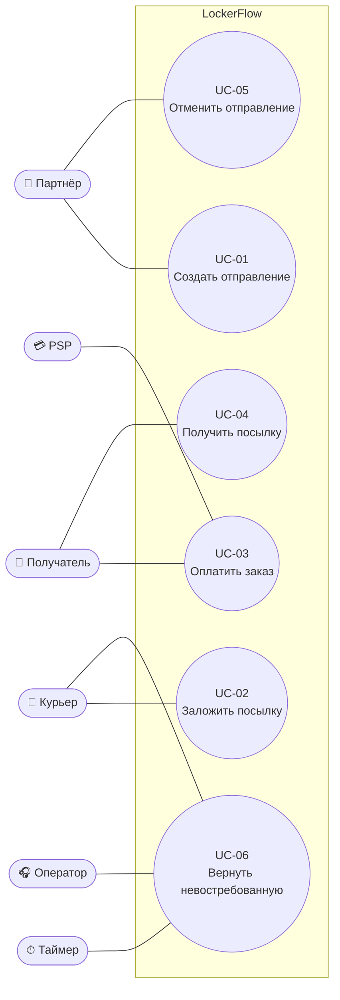

# Сценарии использования (Use Cases)

Сценарии описывают взаимодействие актора с системой как с «чёрным ящиком». Технические детали
(какой сервис, какое событие) вынесены в [диаграммы последовательности](../03-architecture/sequences.md).

---

## UC-01. Создать отправление

| | |
|---|---|
| **Основной актор** | Партнёр (IT-система интернет-магазина) |
| **Цель** | Зарегистрировать заказ к доставке в выбранный постамат и получить гарантию места |
| **Предусловия** | Партнёр активен и имеет API-ключ |
| **Триггер** | Покупатель оформил заказ с доставкой в постамат |
| **Гарантия успеха** | Отправление создано, за ним закреплена ячейка |
| **Минимальная гарантия** | Повтор запроса не создаёт дубль; отказ имеет однозначную причину |

**Основной поток**

1. Партнёр передаёт данные отправления: номер заказа, постамат, размер посылки, получателя, условия оплаты, ключ идемпотентности.
2. Система проверяет API-ключ и корректность данных.
3. Система регистрирует отправление в статусе `CREATED` и подтверждает приём.
4. Система подбирает наименьшую подходящую свободную ячейку в постамате (BR-03) и резервирует её.
5. Система переводит отправление в статус `CELL_RESERVED`, фиксирует номер ячейки и адрес постамата.
6. Если оплата при получении — система открывает счёт на сумму заказа.
7. Партнёр запрашивает статус и видит, что ячейка зарезервирована.

**Альтернативные потоки**

- **2а. API-ключ отсутствует или неизвестен.** Система отвечает `401 UNAUTHORIZED`. Сценарий завершён.
- **2б. Данные некорректны** (формат телефона, сумма не соответствует типу оплаты — BR-02). Система отвечает `400 VALIDATION_ERROR` с перечнем полей. Сценарий завершён.
- **2в. Ключ идемпотентности уже использован с тем же телом.** Система возвращает ранее созданное отправление. Сценарий завершён.
- **2г. Ключ идемпотентности использован с другим телом.** Система отвечает `422 IDEMPOTENCY_KEY_REUSED`.
- **2д. Отправление с таким номером заказа уже есть** (BR-01). Система отвечает `409 DUPLICATE_EXTERNAL_ORDER` и сообщает идентификатор существующего.
- **4а. Постамат не существует.** Отправление переходит в `REJECTED`, причина `LOCKER_NOT_FOUND`.
- **4б. Постамат не работает.** Отправление переходит в `REJECTED`, причина `LOCKER_UNAVAILABLE`.
- **4в. Нет подходящей свободной ячейки.** Отправление переходит в `REJECTED`, причина `NO_FREE_CELLS`.

> **Почему шаг 3 отделён от шага 4.** Подтверждение приёма (202) и резервирование выполняются
> асинхронно: резерв — зона ответственности другого сервиса. Обоснование — [ADR-0004](../03-architecture/adr/0004-choreography-saga.md).

---

## UC-02. Заложить посылку

| | |
|---|---|
| **Основной актор** | Курьер |
| **Цель** | Поместить посылку в зарезервированную ячейку |
| **Предусловия** | Отправление в статусе `CELL_RESERVED`; курьер находится у постамата |
| **Гарантия успеха** | Посылка в ячейке, получатель уведомлён |

**Основной поток**

1. Курьер сканирует штрихкод посылки (идентификатор отправления) на терминале.
2. Система находит резерв отправления в этом постамате.
3. Система открывает зарезервированную ячейку и сообщает её номер.
4. Курьер кладёт посылку и закрывает дверцу.
5. Система помечает ячейку занятой, генерирует код получения (BR-07).
6. Система переводит отправление в `READY_FOR_PICKUP` и устанавливает срок хранения (BR-05).
7. Система отправляет получателю SMS с адресом, кодом и сроком хранения; для заказа с оплатой — суммой и ссылкой (BR-12).

**Альтернативные потоки**

- **2а. Резерва в этом постамате нет** (посылку привезли не туда). Система отвечает `404 RESERVATION_NOT_FOUND`. Курьер везёт посылку в правильный постамат.
- **2б. Резерв не активен** (отправление отменено, посылка уже заложена). Система отвечает `409 INVALID_RESERVATION_STATE`. Курьер возвращает посылку на склад.
- **2в. Постамат переведён в нерабочий режим.** Система отвечает `409 LOCKER_UNAVAILABLE`.

> В прототипе шаги 3–5 объединены в один вызов API: физическое открытие дверцы и датчик закрытия —
> зона прошивки терминала (вне границ MVP).

---

## UC-03. Оплатить заказ

| | |
|---|---|
| **Основной актор** | Получатель |
| **Второстепенный актор** | Платёжный шлюз (PSP) |
| **Цель** | Оплатить заказ, чтобы получить возможность открыть ячейку |
| **Предусловия** | Отправление с оплатой при получении; счёт открыт |
| **Гарантия успеха** | Оплата зафиксирована, ячейка открывается по коду |
| **Минимальная гарантия** | Деньги не списываются дважды; статус платежа не меняется поддельным уведомлением |

**Основной поток**

1. Получатель переходит по ссылке из SMS и подтверждает намерение оплатить.
2. Система проверяет, что счёт открыт, и создаёт платёж на сумму счёта в PSP.
3. Система возвращает ссылку на платёжную страницу PSP.
4. Получатель вводит данные карты на странице PSP и подтверждает оплату.
5. PSP уведомляет систему об успешной оплате.
6. Система проверяет подлинность уведомления, сумму и валюту (BR-11).
7. Система отмечает платёж успешным, счёт — оплаченным, отправление — оплаченным.
8. Система разрешает выдачу посылки по коду и отправляет получателю SMS-подтверждение.

**Альтернативные потоки**

- **2а. Счёт уже оплачен.** Система отвечает `409 ALREADY_PAID`.
- **2б. Счёт закрыт** (отмена, истёк срок хранения — BR-13). Система отвечает `409 INVOICE_CANCELLED`.
- **2в. По счёту есть незавершённый платёж** (BR-10). Система возвращает его вместо создания нового.
- **2г. PSP недоступен.** Система отвечает `502 PSP_UNAVAILABLE`; платёж не создаётся, получатель повторяет попытку.
- **5а. PSP сообщает об отказе.** Система отмечает платёж неуспешным; счёт остаётся открытым, получатель может вернуться к шагу 1.
- **6а. Подпись уведомления неверна.** Система отвечает `401`, ничего не меняет.
- **6б. Сумма или валюта не совпадают.** Система отвечает `422 AMOUNT_MISMATCH`, ничего не меняет; инцидент расследует финансовая служба.
- **6в. Уведомление получено повторно** либо платёж уже в финальном статусе. Система отвечает `200`, ничего не меняет.

---

## UC-04. Получить посылку

| | |
|---|---|
| **Основной актор** | Получатель |
| **Цель** | Забрать посылку из ячейки |
| **Предусловия** | Отправление в статусе `READY_FOR_PICKUP`; получатель знает код |
| **Гарантия успеха** | Ячейка открыта, отправление доставлено, ячейка свободна для следующего резерва |

**Основной поток**

1. Получатель вводит код на терминале постамата.
2. Система проверяет, что ввод кода на постамате не заблокирован.
3. Система находит по коду посылку, хранящуюся в этом постамате.
4. Система проверяет, что оплата не требуется или получена (BR-09).
5. Система открывает ячейку и показывает её номер.
6. Система освобождает ячейку, аннулирует код, обнуляет счётчик неверных попыток.
7. Система переводит отправление в `DELIVERED` и отправляет получателю SMS.

**Альтернативные потоки**

- **2а. Ввод заблокирован** (BR-08). Система отвечает `429 PICKUP_BLOCKED` и сообщает время до разблокировки. Получатель ждёт или обращается в поддержку (оператор снимает блокировку — US-13).
- **3а. Код не найден.** Система увеличивает счётчик неверных попыток, отвечает `403 INVALID_PICKUP_CODE` с числом оставшихся попыток. При пятой ошибке ввод блокируется на 10 минут.
- **4а. Оплата не получена.** Система отвечает `409 PAYMENT_REQUIRED`; терминал предлагает оплатить (UC-03). Попытка не считается неверной.

---

## UC-05. Отменить отправление

| | |
|---|---|
| **Основной актор** | Партнёр |
| **Цель** | Отказаться от доставки и освободить ячейку |
| **Предусловия** | Отправление принадлежит партнёру |

**Основной поток**

1. Партнёр запрашивает отмену отправления, при желании указывая причину.
2. Система проверяет, что посылка ещё не заложена (BR-06).
3. Система переводит отправление в `CANCELLED`.
4. Система освобождает зарезервированную ячейку и закрывает открытый счёт.

**Альтернативные потоки**

- **2а. Отправление уже отменено.** Система возвращает его без изменений (идемпотентность).
- **2б. Посылка заложена или отправление в финальном статусе.** Система отвечает `409 INVALID_SHIPMENT_STATE` с текущим статусом.
- **4а. Отмена пришла раньше, чем ячейка была зарезервирована.** Система зарезервирует и сразу освободит ячейку: события одного отправления обрабатываются строго по порядку.

---

## UC-06. Вернуть невостребованную посылку

| | |
|---|---|
| **Основные акторы** | Таймер (или оператор), Курьер |
| **Цель** | Освободить ячейку от посылки, которую не забрали в срок |
| **Предусловия** | Отправление в статусе `READY_FOR_PICKUP` |

**Основной поток**

1. Наступает момент окончания срока хранения (BR-05).
2. Система переводит отправление в `EXPIRED`.
3. Система аннулирует код получения, закрывает неоплаченный счёт (BR-13), отправляет SMS получателю.
4. Курьер у постамата отмечает изъятие посылки.
5. Система открывает ячейку; курьер забирает посылку.
6. Система освобождает ячейку и переводит отправление в `RETURNED`.

**Альтернативные потоки**

- **1а. Оператор завершает хранение досрочно** (US-14). Далее — с шага 2.
- **4а. Срок хранения не истёк.** Система отвечает `409 INVALID_RESERVATION_STATE`.
- **3а. Заказ был оплачен.** В MVP возврат средств выполняется вручную (открытый вопрос Q-1, история US-18).
