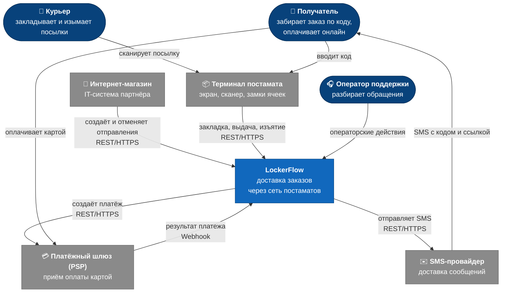
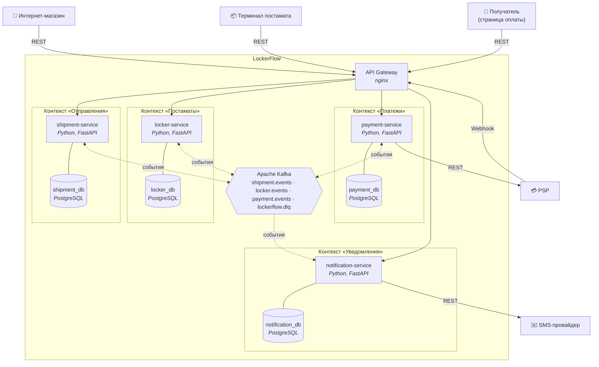
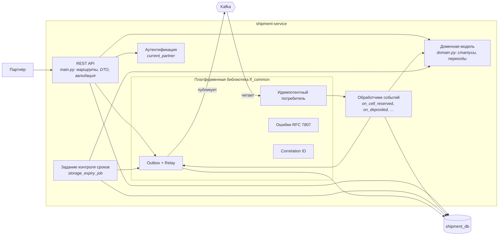
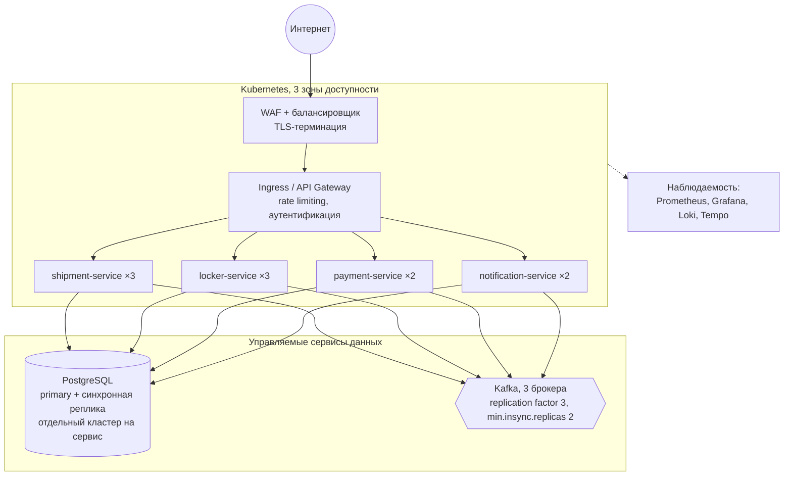

# Архитектура: модель C4

Три уровня детализации: контекст → контейнеры → компоненты. Четвёртый уровень (код) — сам репозиторий.

## Уровень 1. Контекст системы

Кто и зачем взаимодействует с LockerFlow.

Цвета — по соглашению C4: синий — люди, голубой — проектируемая система, серый — внешние системы.

## Уровень 2. Контейнеры

Из чего состоит система и как части общаются между собой.

| Контейнер | Ответственность | Технология | Порт на стенде |
|-----------|-----------------|------------|----------------|
| API Gateway | Единая точка входа, маршрутизация по префиксу, сокрытие `/internal` | nginx 1.27 | 8080 |
| shipment-service | Жизненный цикл отправления, API партнёров, контроль срока хранения | Python 3.12, FastAPI, asyncpg | 8001 |
| locker-service | Постаматы, ячейки, резервы, закладка, выдача, изъятие | то же | 8002 |
| payment-service | Счета, платежи, интеграция с PSP | то же + httpx | 8003 |
| notification-service | Шаблоны и отправка сообщений, журнал | то же | 8004 |
| psp-mock | Тестовый двойник платёжного шлюза (не часть системы) | FastAPI | 8010 |
| Kafka | Асинхронный обмен событиями между сервисами | Apache Kafka 3.9 (KRaft) | — |
| PostgreSQL | По отдельной БД и пользователю на сервис | PostgreSQL 16 | 5432 |

**Ключевые свойства:**

- Между сервисами LockerFlow **нет синхронных вызовов** — только события. Отказ одного сервиса
  не вызывает каскадных отказов ([ADR-0003](adr/0003-async-messaging-kafka.md)).
- У каждого сервиса **своя БД**; чужие данные сервис получает только из событий
  ([ADR-0002](adr/0002-database-per-service.md)).
- Единственный синхронный внешний вызов — `payment-service → PSP` при создании платежа.

## Уровень 3. Компоненты shipment-service

Все сервисы устроены одинаково, поэтому компонентная диаграмма приведена для одного.

| Компонент | Файл | Что делает |
|-----------|------|------------|
| REST API | `services/shipment_service/main.py` | Принимает запросы, валидирует DTO, вызывает доменные операции в транзакции |
| Доменная модель | `services/shipment_service/domain.py` | Перечень статусов и таблица разрешённых переходов. Без инфраструктуры — покрыта unit-тестами |
| Обработчики событий | `main.py`, словарь `HANDLERS` | Реакция на события `locker.*` и `payment.*` |
| Задание контроля сроков | `main.py`, `storage_expiry_job` | Раз в 5 секунд переводит просроченные отправления в `EXPIRED` |
| Outbox + Relay | `libs/lf_common/events.py` | Запись события в одной транзакции с данными, фоновая публикация в Kafka |
| Идемпотентный потребитель | `libs/lf_common/events.py` | Дедупликация по `eventId`, повторы, DLQ, ручной коммит offset |

## Схема развёртывания (целевая, промышленная)

На стенде всё запускается в Docker Compose по одному экземпляру. Целевая схема для выполнения
NFR-06, NFR-11:

