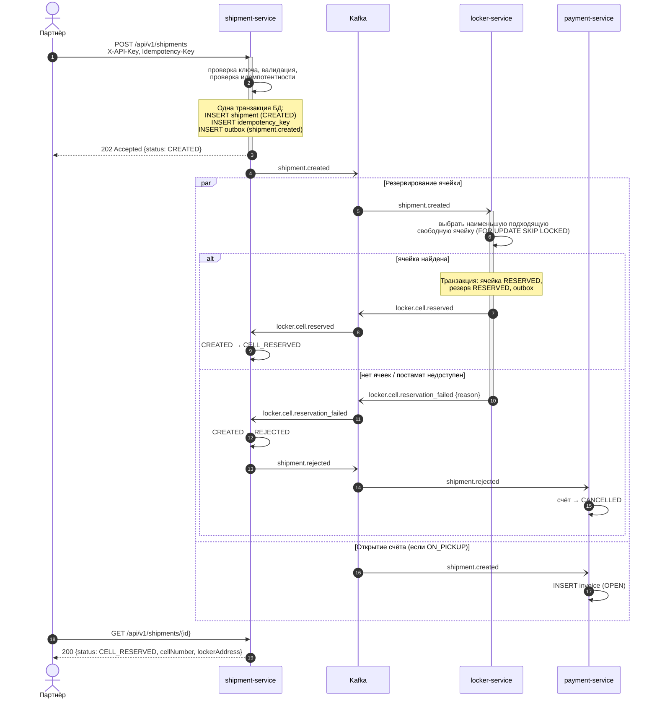
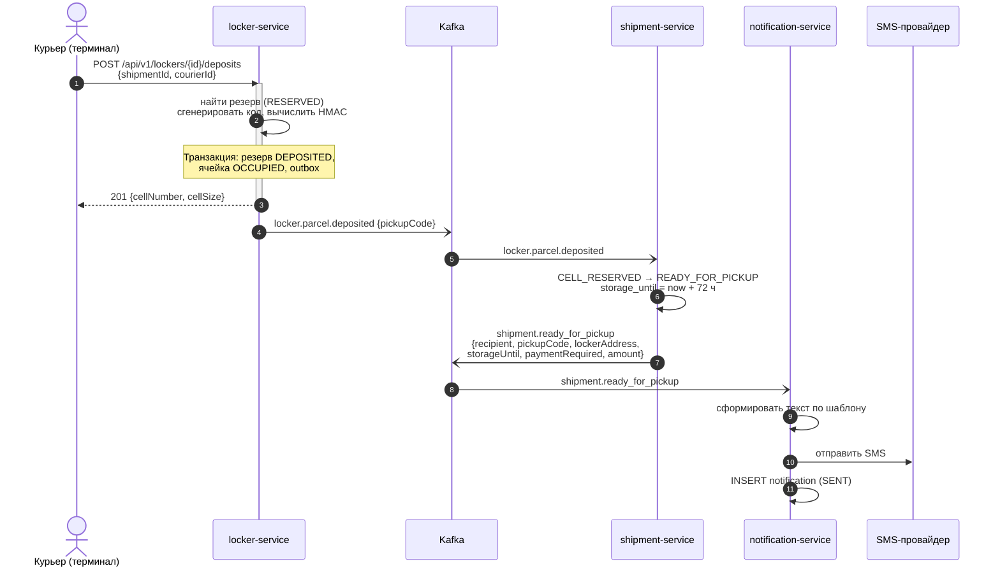
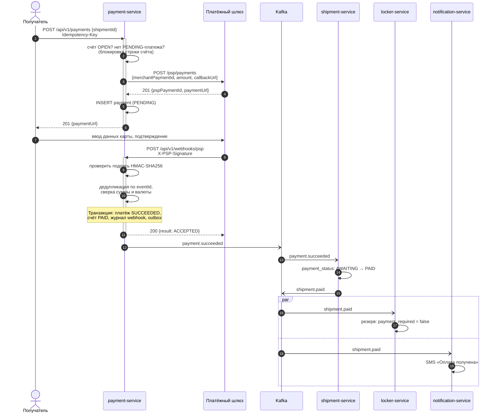
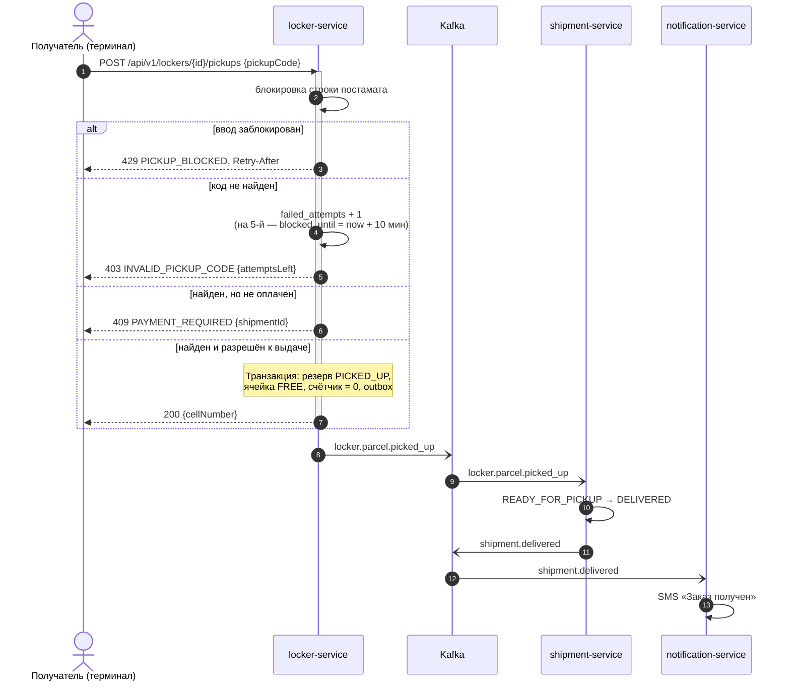
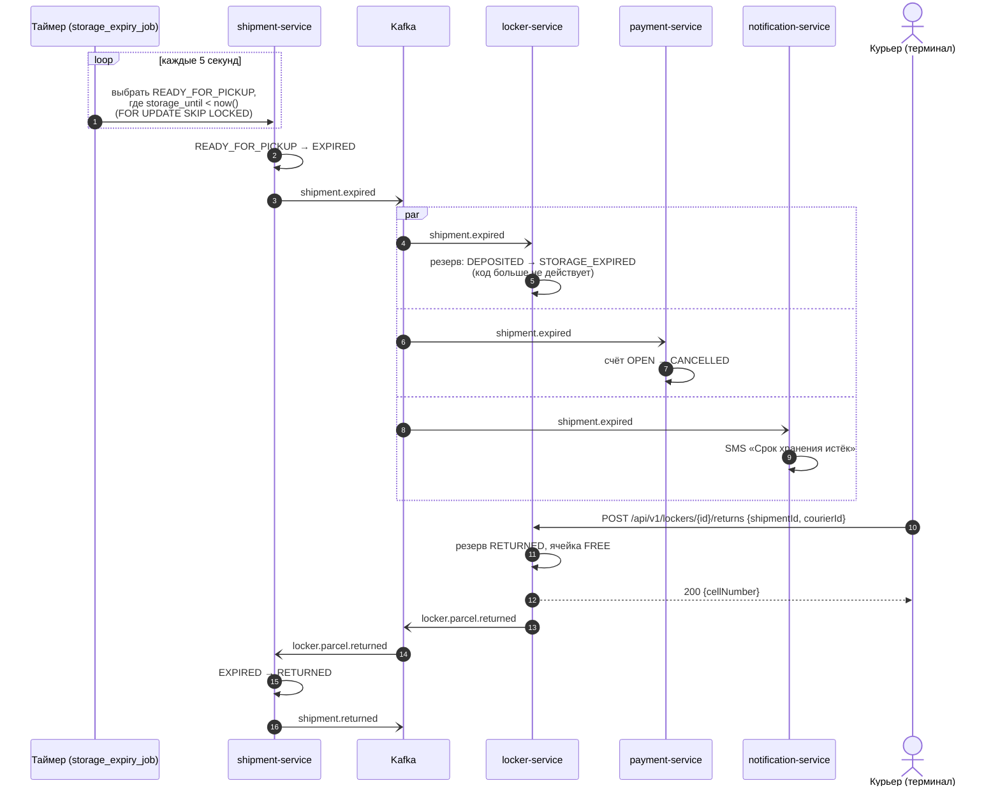
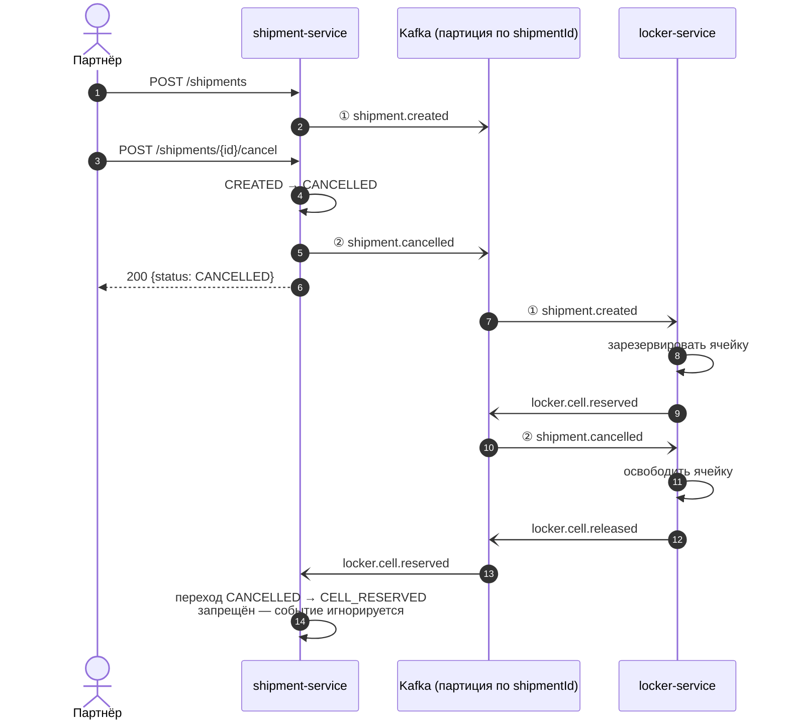
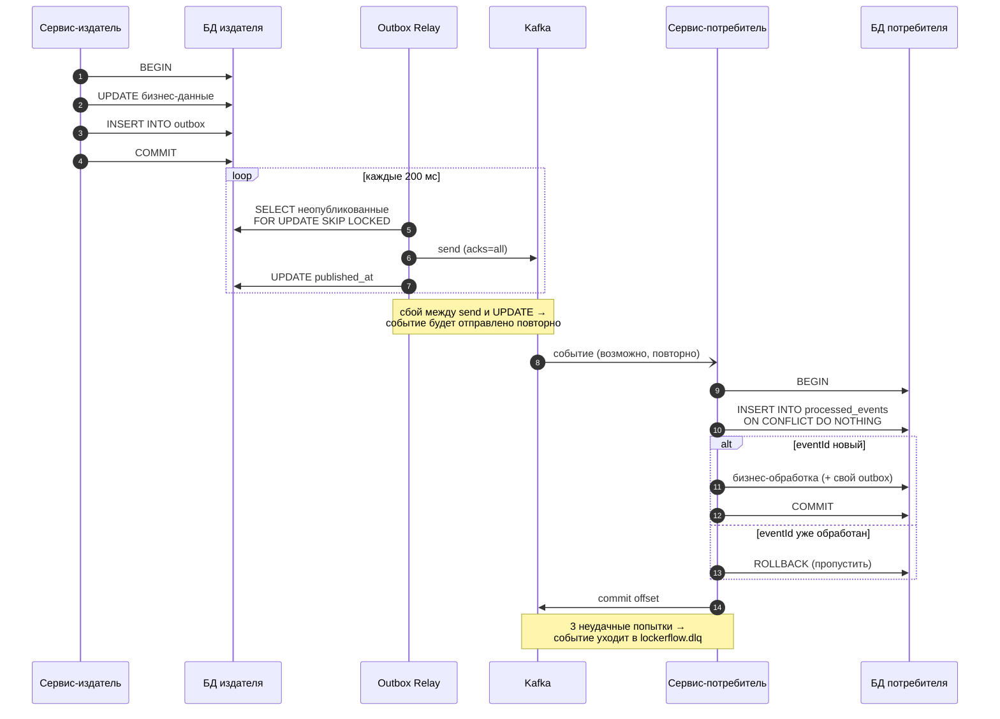

# Диаграммы последовательности

Показывают, **какой сервис что делает** в ключевых сценариях. Сплошная стрелка — синхронный вызов
(REST), пунктирная — асинхронное событие через Kafka. Имена событий и эндпоинтов совпадают
с [AsyncAPI](../05-integration/asyncapi/lockerflow-events.yaml) и [OpenAPI](../05-integration/openapi/).

## SD-01. Создание отправления и резервирование ячейки (сага)

Реализует UC-01. Тесты: TC-01, TC-04, TC-05.

**На что обратить внимание**

- Между шагами 2 и 3: запись данных и события — в одной транзакции (outbox). Событие не может «потеряться» между
  БД и Kafka.
- Компенсация саги при отказе в резерве — перевод отправления в `REJECTED` и закрытие счёта.
- Партнёр узнаёт итог опросом; развитие — webhook (US-16).

## SD-02. Закладка посылки и уведомление получателя

Реализует UC-02. Тесты: TC-01.

**На что обратить внимание**

- Код получения в открытом виде существует только в событии и в SMS; в БД locker-service — только
  HMAC. Компромисс разобран в [ADR-0008](adr/0008-pickup-code-in-event.md).
- `notification-service` не ходит за телефоном получателя в другой сервис: все данные для сообщения
  уже есть в событии (event-carried state transfer).

## SD-03. Оплата при получении

Реализует UC-03. Тесты: TC-02, TC-03, TC-11.

**На что обратить внимание**

- Шаг 3 — единственный синхронный межсистемный вызов. При таймауте PSP получатель видит
  `502 PSP_UNAVAILABLE`, платёж не создаётся, повтор безопасен: PSP идемпотентен по `merchantPaymentId`.
- Шаги 8–11: подпись проверяется **до** разбора тела; дубль уведомления даёт `200` без действий —
  иначе PSP продолжит повторы.
- Между шагом 11 (PSP получил подтверждение) и шагом 17 (постамат узнал об оплате) проходит ненулевое время: получатель, мгновенно введший код, получит
  `409 PAYMENT_REQUIRED`. Целевая задержка — NFR-04 (p95 ≤ 5 с); терминал повторяет запрос.

## SD-04. Выдача посылки

Реализует UC-04. Тесты: TC-01, TC-02, TC-10.

**На что обратить внимание**

- Решение «открывать или нет» принимается **только по локальным данным** locker-service — терминал
  работает, даже если shipment- и payment-сервисы недоступны (NFR-09).
- Блокировка строки постамата сериализует ввод кодов на одном терминале: счётчик попыток нельзя
  обойти параллельными запросами.

## SD-05. Истечение срока хранения и возврат

Реализует UC-06. Тесты: TC-09.

## SD-06. Отмена во время резервирования (гонка)

Реализует UC-05, альтернативный поток 4а. Иллюстрирует, почему важен порядок событий.

**Вывод:** корректность обеспечивают два свойства — (1) события одного отправления лежат в одной
партиции и читаются по порядку, (2) каждый сервис проверяет допустимость перехода по своей машине
состояний. Ячейка не «зависает» в резерве, хотя отмена обогнала резервирование.

## SD-07. Надёжная доставка события (outbox и идемпотентный потребитель)

Технический сценарий, общий для всех сервисов. Обоснование — [ADR-0005](adr/0005-outbox-and-idempotent-consumer.md).

