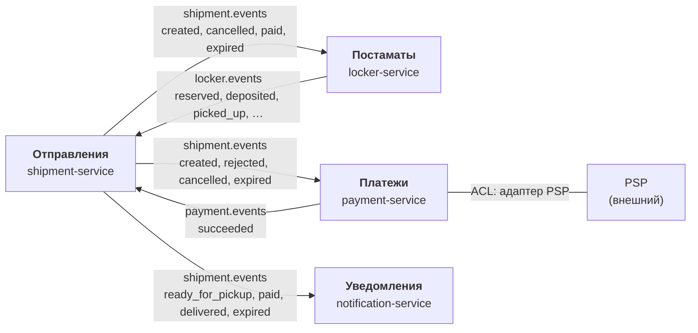

# Декомпозиция на сервисы

## Как выделялись границы

Границы проведены по **ограниченным контекстам** (bounded contexts) предметной области, а не по
техническим слоям. Критерии: у контекста свой язык, свои данные, свой темп изменений и свой владелец
со стороны бизнеса.

| Контекст | Ключевой вопрос, на который отвечает | Владелец со стороны бизнеса | Причины изменений |
|----------|--------------------------------------|-----------------------------|-------------------|
| Отправления | «Что сейчас происходит с заказом?» | Логистика | Новые статусы, условия партнёров |
| Постаматы | «Какая ячейка свободна и кто может её открыть?» | Эксплуатация сети | Новые модели терминалов, правила подбора |
| Платежи | «Кто, сколько и когда заплатил?» | Финансы | Новый PSP, новые способы оплаты, refund |
| Уведомления | «Что и по какому каналу сообщить человеку?» | Клиентский сервис | Тексты, каналы, языки |

## Карта контекстов

- **Отправления ↔ Постаматы** — партнёрство: два контекста совместно ведут сагу, контракт событий согласуется обеими командами.
- **Отправления → Платежи, Уведомления** — поставщик/потребитель: нижестоящие сервисы подстраиваются под опубликованный язык событий отправления.
- **Платежи ↔ PSP** — антикоррупционный слой (ACL): формат PSP не проникает дальше адаптера; замена шлюза не затрагивает остальные сервисы.

## Владение данными

Правило: **у каждой сущности ровно один сервис-владелец**; остальные хранят только нужную им копию
(проекцию), обновляемую по событиям.

| Сущность | Владелец | Кто хранит копию | Что именно копируется | Источник обновления |
|----------|----------|------------------|-----------------------|---------------------|
| Отправление, статус, получатель | shipment | — | — | — |
| Постамат, ячейка, резерв, код | locker | shipment | адрес постамата, номер ячейки | `locker.cell.reserved` |
| Статус оплаты отправления | shipment | locker | признак `payment_required` | `shipment.created`, `shipment.paid` |
| Счёт, платёж | payment | shipment | `payment_status` | `payment.succeeded` |
| Сумма к оплате | shipment | payment | `invoices.amount` | `shipment.created` |
| Сообщение получателю | notification | — | — | — |

Следствие: `locker-service` может решить «открывать ли ячейку», не обращаясь ни к кому по сети —
всё нужное у него есть локально. Это и даёт NFR-09/NFR-10.

## Матрица взаимодействий

| Кто ↓ / Кому → | shipment | locker | payment | notification | PSP | SMS |
|----------------|----------|--------|---------|--------------|-----|-----|
| **shipment** | — | события | события | события | | |
| **locker** | события | — | | | | |
| **payment** | события | | — | | REST (синхр.) | |
| **notification** | | | | — | | REST (синхр.) |
| **PSP** | | | webhook | | — | |

## Почему не иначе

| Альтернатива | Почему отклонена |
|--------------|------------------|
| Монолит | Допустим для MVP, но контексты имеют разных владельцев и разные требования к доступности: выдача на терминале (99,9 %) не должна зависеть от релизов платёжного кода. Подробнее — [ADR-0001](adr/0001-microservices.md) |
| Объединить «Отправления» и «Постаматы» | Самая сильная связность в системе, но разные причины изменений (партнёрские условия против аппаратной части) и разный профиль нагрузки |
| Выделить «Партнёров» в отдельный сервис | Сейчас это одна таблица и проверка ключа; выделение преждевременно. Кандидат на вынос при появлении личного кабинета (US-20) |
| Выделить генерацию кодов в отдельный сервис | Код неотделим от ячейки: его проверяет тот же, кто открывает замок |
