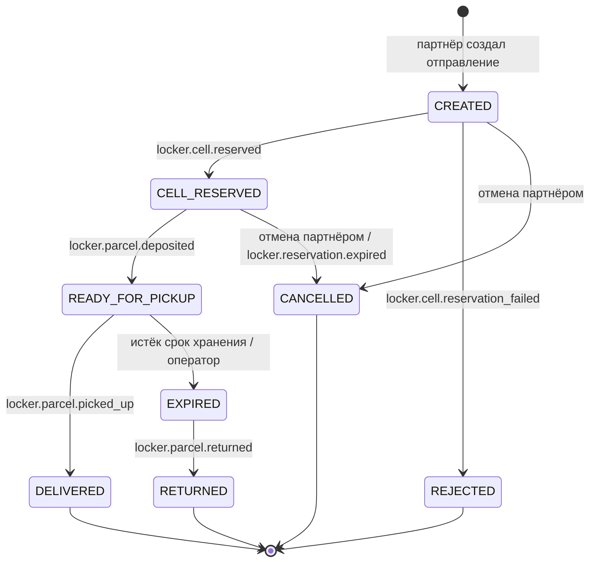
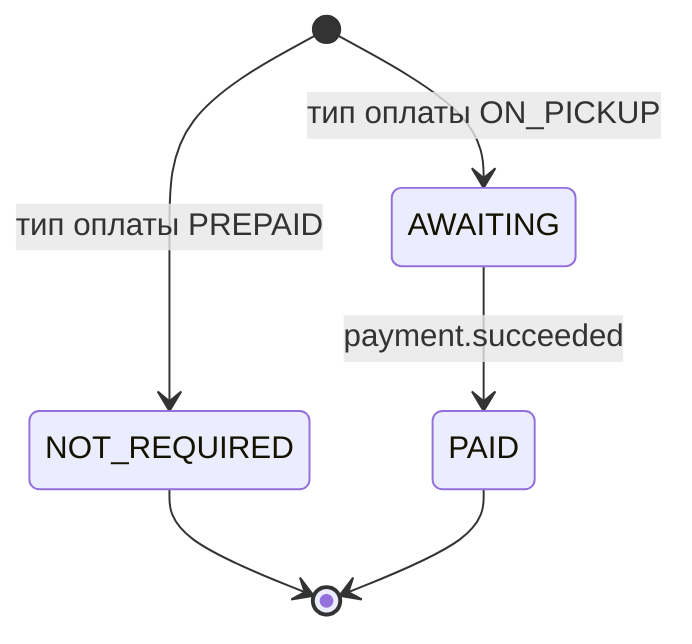
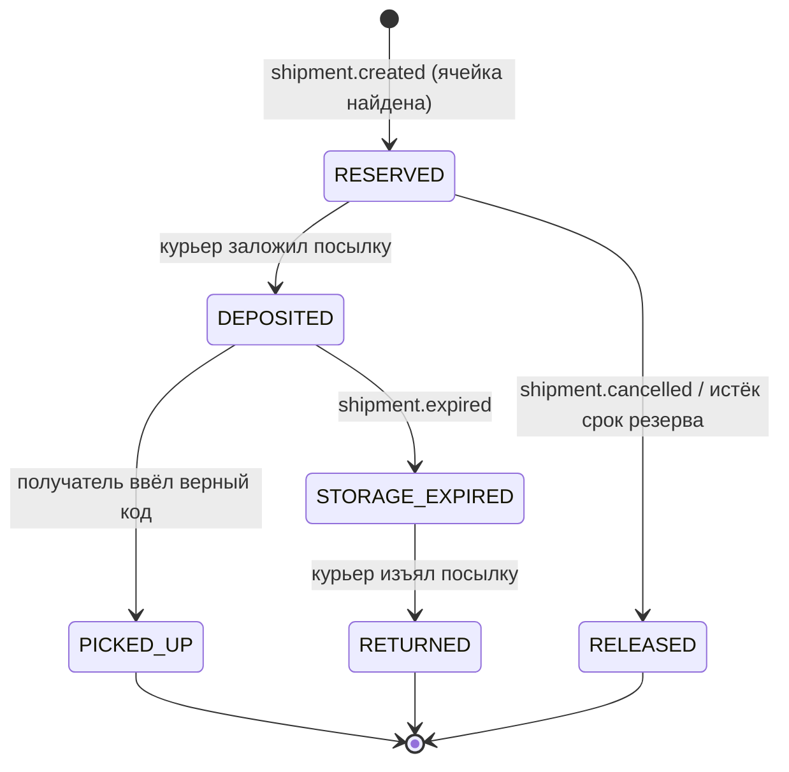
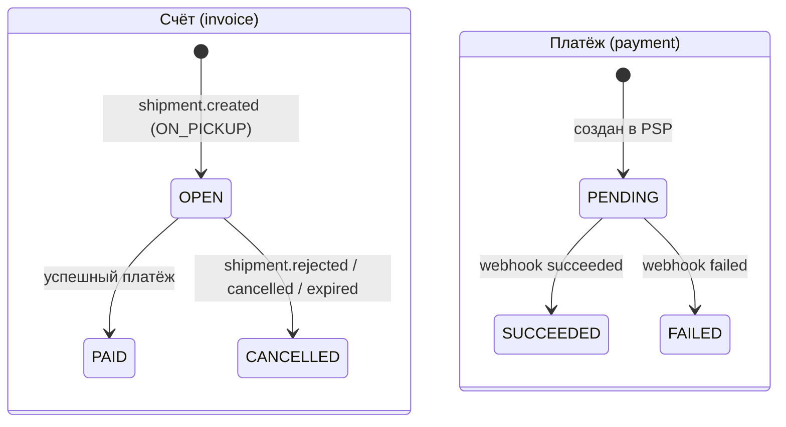

# Машины состояний

Статусная модель — основа системы: по ней написаны таблица переходов в коде
(`services/shipment_service/domain.py`), unit-тест полной матрицы переходов и CHECK-ограничения в БД.

## 1. Отправление (`shipments.status`)

| Из | В | Триггер | Инициатор | Побочные действия | Публикуемое событие |
|----|---|---------|-----------|-------------------|---------------------|
| — | `CREATED` | `POST /shipments` | партнёр | запись ключа идемпотентности | `shipment.created` |
| `CREATED` | `CELL_RESERVED` | `locker.cell.reserved` | locker-service | сохранить номер ячейки и адрес | — |
| `CREATED` | `REJECTED` | `locker.cell.reservation_failed` | locker-service | сохранить причину | `shipment.rejected` |
| `CREATED`, `CELL_RESERVED` | `CANCELLED` | `POST /shipments/{id}/cancel` | партнёр | — | `shipment.cancelled` |
| `CELL_RESERVED` | `CANCELLED` | `locker.reservation.expired` | locker-service | причина `RESERVATION_EXPIRED` | `shipment.cancelled` |
| `CELL_RESERVED` | `READY_FOR_PICKUP` | `locker.parcel.deposited` | locker-service | `storage_until = now + 72 ч` | `shipment.ready_for_pickup` |
| `READY_FOR_PICKUP` | `DELIVERED` | `locker.parcel.picked_up` | locker-service | — | `shipment.delivered` |
| `READY_FOR_PICKUP` | `EXPIRED` | таймер / `POST /internal/…/expire` | система / оператор | причина `STORAGE_EXPIRED` | `shipment.expired` |
| `EXPIRED` | `RETURNED` | `locker.parcel.returned` | locker-service | — | `shipment.returned` |

**Поведение при недопустимом переходе:**

- запрос через API → `409 INVALID_SHIPMENT_STATE` с текущим статусом;
- событие от другого сервиса → игнорируется с записью в лог. Пример: `locker.cell.reserved` пришло
  для уже отменённого отправления — это штатная гонка, а не ошибка; ячейку освободит обработка
  `shipment.cancelled` на стороне locker-service.

### Статус оплаты (`shipments.payment_status`)

Оплата — **независимое измерение**: получатель может оплатить и до закладки, и после. Поэтому это
отдельный атрибут, а не статусы основного жизненного цикла (иначе число состояний удвоилось бы).

## 2. Резерв ячейки (`reservations.status`)

Статус ячейки (`cells.status`) — производная от статуса резерва:

| Статус резерва | Статус ячейки | Код получения |
|----------------|---------------|---------------|
| `RESERVED` | `RESERVED` | ещё не создан |
| `DEPOSITED` | `OCCUPIED` | действует |
| `STORAGE_EXPIRED` | `OCCUPIED` | не действует |
| `PICKED_UP`, `RELEASED`, `RETURNED` | `FREE` | не действует |

Отдельный статус ячейки `OUT_OF_SERVICE` выставляется эксплуатацией (неисправный замок) и исключает
ячейку из подбора.

## 3. Счёт и платёж

Счёт и платёж разделены, потому что относятся как 1 : N — после отказа банка получатель создаёт
новую попытку, а обязательство остаётся одно.

## 4. Соответствие статусов между сервисами

В устойчивом состоянии (все события доставлены) статусы согласованы так:

| Отправление | Резерв | Ячейка | Счёт (если `ON_PICKUP`) |
|-------------|--------|--------|-------------------------|
| `CREATED` | — | — | `OPEN` |
| `CELL_RESERVED` | `RESERVED` | `RESERVED` | `OPEN` / `PAID` |
| `READY_FOR_PICKUP` | `DEPOSITED` | `OCCUPIED` | `OPEN` / `PAID` |
| `DELIVERED` | `PICKED_UP` | `FREE` | `PAID` |
| `REJECTED` | — | — | `CANCELLED` |
| `CANCELLED` | `RELEASED` | `FREE` | `CANCELLED` / `PAID` ⚠️ |
| `EXPIRED` | `STORAGE_EXPIRED` | `OCCUPIED` | `CANCELLED` / `PAID` ⚠️ |
| `RETURNED` | `RETURNED` | `FREE` | `CANCELLED` / `PAID` ⚠️ |

⚠️ Сочетание «отправление не доставлено, счёт оплачен» требует возврата средств — открытый вопрос Q-1,
история US-18. Эта таблица — готовая спецификация для сверочного отчёта (NFR-15).
