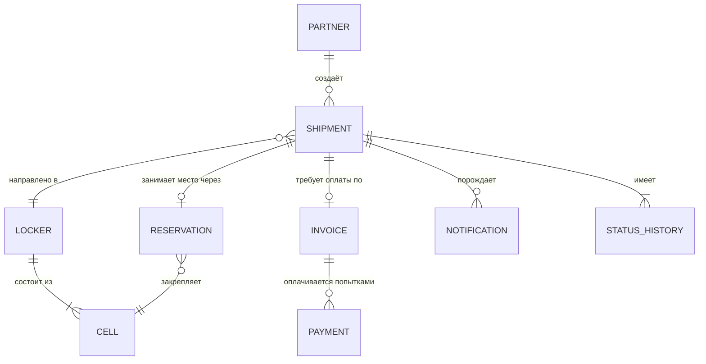
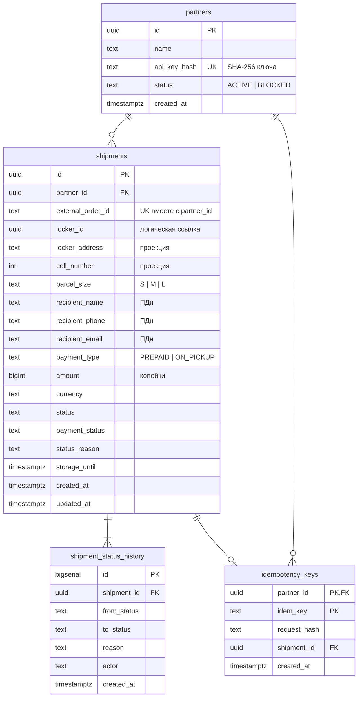
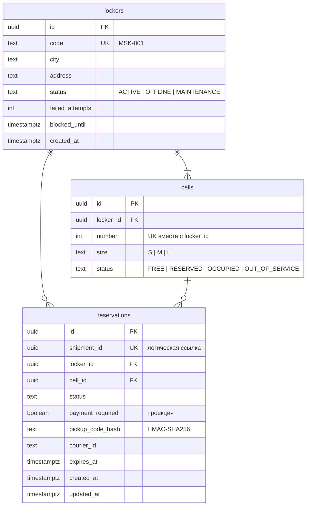
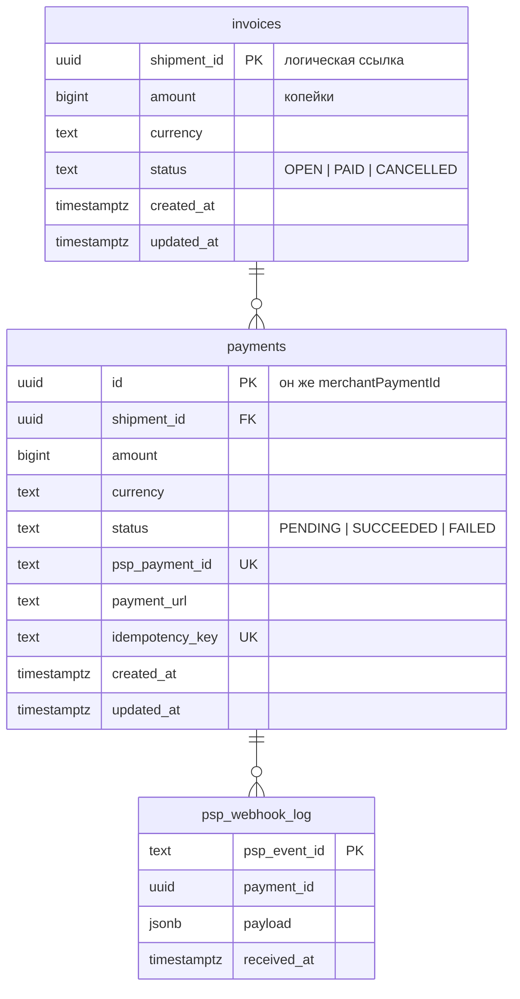
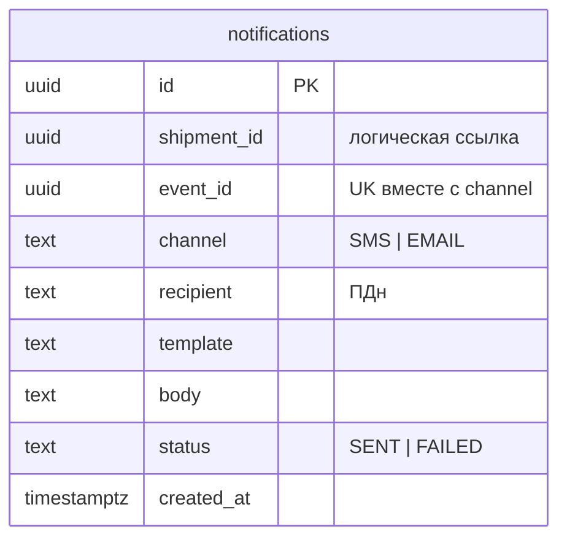
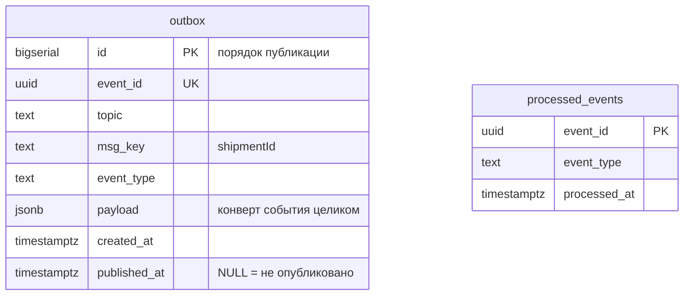

# Модель данных

У каждого сервиса своя база (ADR-0002). Связи между базами — логические, по идентификаторам,
без внешних ключей. DDL находится рядом с кодом сервиса: `services/<service>/schema.sql`.

## Концептуальная модель

Сущности предметной области и связи между ними — без привязки к сервисам и таблицам.

## shipment_db

### Словарь данных: `shipments`

| Атрибут | Тип | Обяз. | Описание | Ограничения и правила |
|---------|-----|:-----:|----------|-----------------------|
| `id` | uuid | ✔ | Идентификатор отправления, генерируется системой | PK. Используется как ключ сообщений Kafka и в ссылке на оплату |
| `partner_id` | uuid | ✔ | Партнёр-владелец | FK → `partners.id` |
| `external_order_id` | text | ✔ | Номер заказа в системе партнёра | 1–64 символа; `UNIQUE (partner_id, external_order_id)` — BR-01 |
| `locker_id` | uuid | ✔ | Постамат назначения | Логическая ссылка на `locker_db.lockers.id`; существование проверяется асинхронно |
| `locker_address` | text | | Адрес постамата | Заполняется из события `locker.cell.reserved` |
| `cell_number` | int | | Номер ячейки | Заполняется из события `locker.cell.reserved` |
| `parcel_size` | text | ✔ | Размер посылки | `S`, `M`, `L` |
| `recipient_name` | text | ✔ | Имя получателя | 1–200 символов. **ПДн** |
| `recipient_phone` | text | ✔ | Телефон получателя | Формат E.164: `+` и 10–15 цифр. **ПДн** |
| `recipient_email` | text | | E-mail получателя | Формат RFC 5322. **ПДн** |
| `payment_type` | text | ✔ | Тип оплаты | `PREPAID`, `ON_PICKUP` |
| `amount` | bigint | ✔ | Сумма к оплате в копейках | ≥ 0; BR-02: > 0 для `ON_PICKUP`, = 0 для `PREPAID`; ≤ 50 000 000 |
| `currency` | text | ✔ | Валюта | Только `RUB` (C-3) |
| `status` | text | ✔ | Статус жизненного цикла | См. [state-machines.md](../03-architecture/state-machines.md) |
| `payment_status` | text | ✔ | Статус оплаты | `NOT_REQUIRED`, `AWAITING`, `PAID` |
| `status_reason` | text | | Причина последней смены статуса | `NO_FREE_CELLS`, `LOCKER_NOT_FOUND`, `LOCKER_UNAVAILABLE`, `RESERVATION_EXPIRED`, `STORAGE_EXPIRED`, `CANCELLED_BY_PARTNER` или текст партнёра |
| `storage_until` | timestamptz | | Окончание срока хранения | Устанавливается при закладке: момент закладки + 72 ч (BR-05) |
| `created_at`, `updated_at` | timestamptz | ✔ | Служебные отметки времени | UTC |

Индексы:

| Индекс | Назначение |
|--------|------------|
| `UNIQUE (partner_id, external_order_id)` | BR-01 и поиск по номеру заказа |
| `(storage_until) WHERE status = 'READY_FOR_PICKUP'` | Частичный индекс для задания контроля сроков — содержит только «живые» посылки |
| `(partner_id, status, created_at DESC)` | Список отправлений партнёра с фильтром по статусу |

## locker_db

### Словарь данных: `reservations`

| Атрибут | Тип | Обяз. | Описание | Ограничения и правила |
|---------|-----|:-----:|----------|-----------------------|
| `id` | uuid | ✔ | Идентификатор резерва | PK |
| `shipment_id` | uuid | ✔ | Отправление | `UNIQUE` — одно отправление занимает не более одной ячейки (A-4) |
| `locker_id` | uuid | ✔ | Постамат | FK; дублирует `cells.locker_id` ради индекса поиска по коду |
| `cell_id` | uuid | ✔ | Ячейка | FK → `cells.id` |
| `status` | text | ✔ | Статус резерва | `RESERVED`, `DEPOSITED`, `PICKED_UP`, `RELEASED`, `STORAGE_EXPIRED`, `RETURNED` |
| `payment_required` | boolean | ✔ | Нужно ли дождаться оплаты перед выдачей | Проекция: `true` при `ON_PICKUP`, сбрасывается событием `shipment.paid` (BR-09) |
| `pickup_code_hash` | text | | Хэш кода получения | `HMAC-SHA256(pepper, locker_id + ':' + code)`; заполняется при закладке (BR-07) |
| `courier_id` | text | | Курьер, выполнивший закладку | Для разбора инцидентов |
| `expires_at` | timestamptz | ✔ | До какого момента резерв ждёт закладки | Создание + 5 суток (BR-04) |

Индексы:

| Индекс | Назначение |
|--------|------------|
| `UNIQUE (locker_id, pickup_code_hash) WHERE status = 'DEPOSITED'` | Поиск посылки по коду и гарантия уникальности действующих кодов в постамате (BR-07) |
| `(expires_at) WHERE status = 'RESERVED'` | Задание освобождения просроченных резервов |
| `cells (locker_id, size) WHERE status = 'FREE'` | Подбор свободной ячейки (BR-03) |

**Как обеспечена NFR-16** (ячейка не достаётся двоим): выборка ячейки выполняется запросом
`SELECT … WHERE status = 'FREE' … FOR UPDATE SKIP LOCKED LIMIT 1` — строка блокируется до конца
транзакции, а параллельная транзакция пропускает её и берёт следующую.

## payment_db

| Таблица | Назначение | Особенности |
|---------|------------|-------------|
| `invoices` | Обязательство оплатить отправление | Создаётся по событию `shipment.created`; первичный ключ — `shipment_id` (счёт и отправление связаны 1 : 1) |
| `payments` | Попытки оплаты счёта | `id` передаётся в PSP как `merchantPaymentId` — по нему PSP обеспечивает идемпотентность, а webhook находит платёж |
| `psp_webhook_log` | Журнал принятых уведомлений PSP | Первичный ключ `psp_event_id` обеспечивает дедупликацию (FR-25); хранит исходное тело для сверки и разбора спорных ситуаций |

Карточные данные в базе отсутствуют (C-1, NFR-20).

## notification_db

`UNIQUE (event_id, channel)` — вторая линия защиты от повторной отправки (FR-28): даже если запись
в `processed_events` была бы утрачена, одно событие не породит два сообщения в один канал.

## Служебные таблицы (в каждой базе)

| Таблица | Роль | Обслуживание |
|---------|------|--------------|
| `outbox` | Исходящие события, записанные атомарно с бизнес-данными (ADR-0005) | Удалять опубликованные записи старше 7 суток; алерт, если есть неопубликованная запись старше 30 с |
| `processed_events` | Идентификаторы обработанных событий — дедупликация | Удалять записи старше срока хранения сообщений в Kafka (7 суток) |

## Персональные данные

| Данные | Где хранятся | Основание обработки | Срок хранения | Меры |
|--------|--------------|---------------------|---------------|------|
| Имя, телефон, e-mail получателя | `shipment_db.shipments` | Исполнение договора доставки | 3 года после финального статуса, затем обезличивание (NFR-25) | Доступ только у shipment-service; шифрование диска |
| Телефон и текст сообщения | `notification_db.notifications` | То же | 90 дней | Маскирование кода получения в тексте (NFR-24) |
| Телефон в событиях | Kafka, топик `shipment.events` | То же | 7 суток (срок хранения топика) | ACL на чтение топика |

## Оценка объёмов (допущения)

При 20 000 отправлений в сутки:

| Таблица | Строк в год | Примерный объём в год | Вывод |
|---------|-------------|-----------------------|-------|
| `shipments` | 7,3 млн | ≈ 4 ГБ | Секционирование не требуется на горизонте 3 лет |
| `shipment_status_history` | ≈ 25 млн | ≈ 3 ГБ | Кандидат на секционирование по месяцам |
| `outbox` (все сервисы) | ≈ 70 млн до очистки | при очистке — десятки МБ | Очистка обязательна |
| `notifications` | ≈ 15 млн | ≈ 5 ГБ | Срок хранения 90 дней ограничивает рост |
