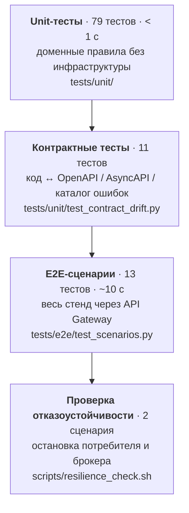

# Стратегия тестирования

## Уровни



| Уровень | Что проверяет | Чего не проверяет | Когда запускается |
|---------|---------------|-------------------|-------------------|
| Unit | Таблицу переходов статусов (полная матрица 8×8), подбор размера ячейки, формат и хэширование кода, подпись webhook, шаблоны сообщений, формат конверта события | Взаимодействие с БД и Kafka | Каждый коммит |
| Контрактные | Совпадение маршрутов приложения с OpenAPI; событий и подписок — с AsyncAPI; кодов ошибок — с каталогом | Соответствие схем полей | Каждый коммит |
| E2E | Бизнес-сценарии целиком: REST → БД → outbox → Kafka → потребитель → БД другого сервиса | Нагрузку, поведение при отказах | Каждый коммит (в CI поднимается стенд) |
| Отказоустойчивость | Сохранность событий при остановке сервиса-потребителя и брокера (NFR-08) | Отказ БД, сетевые разделения | Вручную перед релизом |

## Почему доменная логика вынесена в чистые модули

Правила, которые чаще всего меняет бизнес (статусная модель, подбор ячейки, шаблоны), лежат в файлах
`domain.py` и `templates.py` без единого обращения к БД или сети. Это даёт:

- проверку **всех** комбинаций, а не только избранных: матрица переходов — 64 случая за миллисекунды;
- тест как исполняемую спецификацию: `ALLOWED` в `test_shipment_domain.py` дословно повторяет
  диаграмму состояний.

## Особенности тестирования асинхронной системы

Система согласована только в конечном счёте, поэтому e2e-тест не может проверять результат сразу
после вызова. Используется ожидание с опросом (`wait_for`: шаг 200 мс, таймаут 20 с):

```python
create(shipment)                          # 202, статус CREATED
wait_status(shipment_id, "CELL_RESERVED") # событие дошло до locker и обратно
```

Правила, которых придерживаются тесты:

1. **Не использовать `sleep` фиксированной длины** — только ожидание условия.
2. **Тест сам создаёт свои данные** (уникальный `externalOrderId`) и не зависит от порядка запуска.
3. **Тест возвращает общий ресурс в исходное состояние**: освобождает единственную ячейку постамата
   MSK-002, снимает блокировку ввода кода.
4. **Код получения берётся там же, где его берёт человек** — из текста SMS (журнал уведомлений).

## Тестовые двойники

| Внешняя система | Двойник | Что умеет |
|-----------------|---------|-----------|
| Платёжный шлюз | `services/psp_mock` — отдельный сервис | Создаёт платёж, отдаёт платёжную страницу, шлёт подписанный webhook; по флагу `duplicate` — дважды; исход `succeeded` / `failed` |
| SMS-провайдер | Заглушка внутри notification-service | Пишет сообщение в лог и журнал уведомлений |
| Терминал и приложение курьера | Прямые вызовы API в тестах | — |

## Тестовые данные стенда

| Постамат | Идентификатор | Особенность | Для каких сценариев |
|----------|---------------|-------------|---------------------|
| MSK-001 | `11111111-1111-4111-8111-111111111111` | 20 ячеек (10 S, 6 M, 4 L) | Основные сценарии |
| SPB-001 | `22222222-2222-4222-8222-222222222222` | 20 ячеек | Заполнение ячеек размера L, подбор кода |
| MSK-002 | `33333333-3333-4333-8333-333333333333` | Единственная ячейка S | «Нет свободных ячеек» |
| KZN-001 | `44444444-4444-4444-8444-444444444444` | Статус `OFFLINE` | «Постамат недоступен» |

Партнёр: API-ключ `demo-partner-key`.

## Что не покрыто и почему

| Область | Причина | Как закрыть |
|---------|---------|-------------|
| Срабатывание заданий по таймеру (BR-04, BR-05) | Время не подменяется; логика истечения хранения проверена через операторское действие, истечение резерва — не проверено | Инжектируемые часы либо стенд с короткими TTL |
| Гонки при высокой конкуренции за последнюю ячейку | Нужен нагрузочный инструмент | Сценарий k6: 100 параллельных созданий на постамат с 1 ячейкой, ожидание ровно одного `CELL_RESERVED` |
| Производительность (NFR-01…NFR-05) | Вне рамок прототипа | k6 + профиль нагрузки из допущения A-3 |
| Отказ БД, сетевые задержки | Нужен инструмент внесения сбоев | Toxiproxy между сервисами и PostgreSQL/Kafka |
| Проверка тел ответов по JSON-схемам из OpenAPI | Контрактный тест сравнивает только маршруты | Schemathesis |
| Безопасность | Аутентификация терминала и курьера не реализована (ADR-0007) | После реализации — тесты авторизации и пентест |

## Критерии выхода (Definition of Done для релиза)

- Все unit-, контрактные и e2e-тесты зелёные в CI.
- `scripts/resilience_check.sh` пройден на релизном стенде.
- Для каждой новой истории есть тест-кейс в [test-cases.md](test-cases.md) и строка в матрице трассировки.
- Изменение API отражено в OpenAPI/AsyncAPI (иначе контрактный тест не пройдёт).
