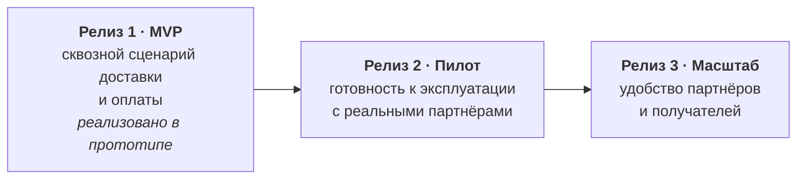

# Дорожная карта и бэклог

## Этапы

| Релиз | Цель | Критерий готовности |
|-------|------|---------------------|
| 1. MVP | Доказать сквозной сценарий: заказ → ячейка → оплата → выдача → возврат | Все сценарии TC-01…TC-12 проходят на стенде ✅ |
| 2. Пилот | Запустить 10 постаматов с 2–3 партнёрами | Закрыты блокирующие риски R-01, R-07; выполнены NFR безопасности и наблюдаемости |
| 3. Масштаб | 500 постаматов, самообслуживание партнёров | Выполнены NFR-01…NFR-07 под целевой нагрузкой |

## Релиз 1 · MVP (реализовано)

| История | SP | Статус |
|---------|----|--------|
| US-01 Создать отправление | 8 | ✅ |
| US-02 Узнать статус | 3 | ✅ |
| US-03 Отменить отправление | 5 | ✅ |
| US-04 Постаматы со свободными ячейками | 3 | ✅ |
| US-05 Заложить посылку | 5 | ✅ |
| US-06 Получить код | 3 | ✅ |
| US-07 Забрать по коду | 8 | ✅ |
| US-08 Оплатить онлайн | 13 | ✅ |
| US-09 Отследить заказ | 2 | ✅ |
| US-10 Авто-завершение хранения | 5 | ✅ |
| US-11 Изъять посылку | 3 | ✅ |
| US-12 Освободить просроченный резерв | 3 | ✅ (без автотеста) |
| US-13…US-15 Действия поддержки | 6 | ✅ |
| **Итого** | **67** | |

## Релиз 2 · Пилот

Приоритизация по WSJF: (ценность для бизнеса + критичность по времени + снижение риска) / трудоёмкость.
Оценки — экспертные, по шкале 1–10.

| # | Задача | Ценность | Срочность | Снижение риска | Трудоёмкость | WSJF | Источник |
|---|--------|:--------:|:---------:|:--------------:|:------------:|:----:|----------|
| 1 | Аутентификация терминалов (mTLS) и курьеров (JWT) | 6 | 10 | 10 | 5 | 5,2 | ADR-0007, R-07 |
| 2 | Метрики, алерты на DLQ / outbox / lag | 5 | 8 | 9 | 5 | 4,4 | NFR-28, NFR-29 |
| 3 | Автоматический возврат средств за оплаченные и не полученные заказы | 8 | 8 | 8 | 8 | 3,0 | US-18, Q-1, R-01 |
| 4 | Интеграция с реальным SMS-провайдером, повторы и отчёты о доставке | 9 | 9 | 6 | 8 | 3,0 | INT-07, R-03 |
| 5 | Маскирование ПДн и кода получения в журналах | 4 | 6 | 8 | 3 | 6,0 | NFR-24, ADR-0008 |
| 6 | Ограничение частоты запросов на шлюзе | 3 | 5 | 7 | 3 | 5,0 | NFR-23 |
| 7 | Регламентная очистка `outbox`, `processed_events`, ключей идемпотентности | 2 | 4 | 6 | 2 | 6,0 | ADR-0005, ADR-0006 |
| 8 | Сверочный отчёт статусов между сервисами | 5 | 4 | 8 | 5 | 3,4 | NFR-15 |
| 9 | Нагрузочные сценарии и тест конкуренции за ячейку | 4 | 5 | 7 | 5 | 3,2 | NFR-01…NFR-05 |

Порядок выполнения по убыванию WSJF: 5 → 7 → 1 → 6 → 2 → 8 → 9 → 3 → 4. Задачи 3 и 4 при этом
**обязательны** для выхода на пилот независимо от балла — без них нельзя работать с реальными
получателями; низкий WSJF у них из-за трудоёмкости, поэтому их начинают параллельно с первых дней.

## Релиз 3 · Масштаб

| История | Ценность |
|---------|----------|
| US-16 Webhook партнёру о смене статуса | Партнёры перестают опрашивать API; снижение нагрузки |
| US-19 Напоминание за 24 часа до конца хранения | Снижение доли невостребованных (BG-2) |
| US-17 Платное продление хранения | Дополнительная выручка |
| US-20 Личный кабинет партнёра | Самообслуживание: ключи, отчёты, сверка (BG-4) |
| Выдача по QR-коду (Q-3) | Удобство и стойкость к подбору |
| Офлайн-режим терминала | Выдача при потере связи (снятие ограничения C-4) |
| Переход outbox на CDC | Снижение нагрузки на БД при росте потока (ADR-0005) |

## Технический долг прототипа

Сознательные упрощения, которые нужно устранить до промышленной эксплуатации:

| # | Упрощение | Чем грозит | Где описано |
|---|-----------|------------|-------------|
| TD-1 | Схема БД применяется при старте сервиса (`CREATE TABLE IF NOT EXISTS`) | Нет управляемых миграций и откатов | — → инструмент миграций |
| TD-2 | Один экземпляр PostgreSQL и Kafka | Единая точка отказа | [c4.md](../03-architecture/c4.md), целевая схема |
| TD-3 | Секреты в `docker-compose.yml` | Допустимо только для стенда | → хранилище секретов |
| TD-4 | Закладка — один вызов вместо «открыть → подтвердить закрытие дверцы» | Нет обработки «курьер не закрыл дверцу» | UC-02 |
| TD-5 | Блокировка ввода кода — на весь постамат | Один нарушитель мешает всем получателям | Q-2 |
| TD-6 | `courierId` передаётся в теле запроса | Подмена исполнителя | ADR-0007 |
| TD-7 | Нет автотеста на истечение резерва | Регрессия BR-04 останется незамеченной | [traceability-matrix.md](../02-requirements/traceability-matrix.md) |
